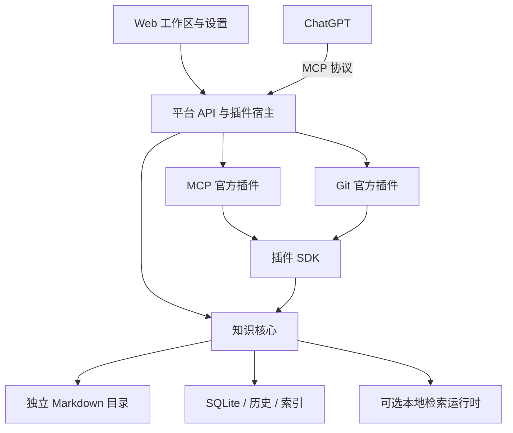

# DooKnow

**面向个人与 AI 协作的 Markdown 知识平台。**

用浏览器整理、阅读和编辑自己的资料，让 ChatGPT 在授权范围内检索和维护知识。Markdown 原文保存在你选择的服务器目录中，MCP、Git 和本地检索按需启用。

DooKnow 将原有 Web 工作区与 `doo-know-bridge` 的 MCP 能力统一到一个平台。新安装通过官方插件提供 MCP 服务，无需另外部署旧 Bridge；知识库原文与平台源码仍分别保存、独立管理。

[安装](#安装) · [官方插件](#官方插件) · [日常管理](#日常管理) · [开发](#开发) · [文档](#文档)

## 可以做什么

「应用 → To Doo」提供与知识库关联的任务、目标和日程工作区，包含大纲、看板、日历、时间线、四象限、专注、习惯、纪念日、成果与复盘，并支持日历/数据交换和独立授权的 MCP 协作。长期记录按实体保存到知识库 `_data/apps/to-doo/`，随知识库 Git 与备份迁移。[使用与数据说明](docs/ToDoo使用与数据.md)

| 能力               | 使用方式                                                                        |
| ------------------ | ------------------------------------------------------------------------------- |
| 管理 Markdown 资料 | 浏览目录、快速记录、移动与重命名、编辑、预览和章节定位，支持桌面和手机浏览器    |
| 保留修改记录       | 查看笔记历史、恢复版本和回收站内容；外部修改发生冲突时保留草稿并提示核对        |
| 阅读大文件         | 分页读取与片段编辑，避免一次加载整篇大文档                                      |
| 分享单篇笔记       | 设置期限或永久分享，选择仅查看或允许编辑，管理分享入口与附件访问                  |
| 连接 ChatGPT       | 安装 MCP 插件，配置连接、授权范围，查看客户端及调用状态                         |
| 管理 Git 版本      | 查看历史、差异和恢复笔记；从 GitHub/Gitee 导入，或关联本地知识库后手动提交推送、拉取 |
| 使用本地检索       | 按需准备检索运行时和模型，下载完成后离线运行                                    |

笔记通过保存按钮或 `Ctrl/Cmd + S` 写回原文。未保存内容会在当前浏览器中暂存本地草稿，刷新后可明确选择恢复或复制；本地草稿不会自动写回原文，也不代替服务器备份。保存期间继续输入的内容会保留，大文件草稿记录原片段范围；原文基准或编辑模式变化时只允许复制恢复，避免错位覆盖。退出登录会清理当前账户在该浏览器中的草稿，并阻止旧标签页写回。

分享可选择1小时、1天、7天、30天、自定义到期时间或永久，新链接默认7天、仅查看。允许编辑时，访客无需登录即可手动保存普通 Markdown 到原文，保留历史并检查并发冲突；到期、撤销、重置链接或改为只读后会阻止后续保存。已有永久只读链接保持有效。公开编辑限1 MiB内且单行不超过32 KiB的普通 Markdown；大文件和白板只读，访客不能上传附件或增加新的本地附件引用。

侧栏搜索可选择文本、语义或混合检索，按目录筛选，并打开命中行。混合检索在语义组件不可用时明确降级；语义模式需要先准备本地检索。笔记地址会随选择更新，支持刷新、前进后退和未保存确认。浏览与编辑不依赖模型下载成功。

文件名与目录路径可直接搜索，完整名称和路径优先于部分名称；正文检索的多个有效关键词需要共同命中。完整 Markdown 文件名、路径和引号短语还会核对字面内容，避免仅凭 `.md` 等公共词返回无关资料。按意思寻找资料可使用语义或混合模式。分页取得正文命中后，会更新原先文件名结果的摘要与定位。

目录树默认折叠，点击箭头逐层展开。右键点击目录或笔记，或点击条目右侧的“⋯”，可打开对应功能菜单；手机上直接点击“⋯”。目录支持在当前目录新建笔记、子文件夹和导入 Markdown，笔记支持重命名或移动、下载已保存原文和移入回收站，两者均可复制相对路径。切换操作保留未保存提醒，移入回收站需再次确认。普通笔记采用顶部操作栏、正文与章节目录的布局；编辑和预览模式在内容区右侧常驻显示目录，分屏模式通过“章节目录”按钮打开和收起浮层。目录按当前正文的 H1～H5 标题显示父子层级，支持点击定位和当前章节高亮，修改标题时同步更新，无需提前保存。有子章节的标题前显示折叠箭头，点击箭头可逐级收起或展开，点击标题仍定位正文；同篇笔记切换显示模式时保留折叠状态，切换笔记后重新展开。

文档顶部提供路径导航、撤销重做和 Markdown 格式工具栏，可设置标题、粗体、斜体、删除线、引用、列表、代码、链接、表格、段落对齐和文字颜色。文字颜色使用包含默认色和 36 个常用色块的色板，自定义 HEX 色值先预览、确认后应用。格式操作只修改当前草稿，仍需手动保存；切换预览后保留撤销记录。

桌面左侧使用独立窄功能栏，账号位于顶部，笔记、回收站、设置和后台状态保持可达；收起目录后仍可使用功能栏。目录栏将搜索与新建分行显示，目录页的新建和导入操作集中在标题旁。新建、移动和导入使用可搜索的树状目录选择器，下拉列表按窗口可用空间上下展开并独立滚动。手机继续使用抽屉导航。头像菜单管理账号、帮助和退出登录；导入位于新建按钮旁的展开菜单及目录页面。进入设置后，左侧显示七个独立分类，返回笔记会保留原有编辑器、目录展开和搜索上下文。字体、阅读宽度、自动换行、行号、默认视图及浅色/深色/系统主题按账户保存在当前浏览器，预览后显式保存，不修改笔记原文。

## 安装

源码与发行包已公开，安装、官方插件和本地检索包下载均无需 GitHub Token。

```bash
curl -fsSL 'https://raw.githubusercontent.com/bandoo-2001/doo-know/txj/doo-know-platform/deploy/github-install.sh' | bash
```

```bash
wget -qO- 'https://raw.githubusercontent.com/bandoo-2001/doo-know/txj/doo-know-platform/deploy/github-install.sh' | bash
```

安装器下载固定版本并校验SHA-256，内含Node与生产依赖，无需Docker、全局Node/Python、npm编译或sudo。Linux x86_64、glibc ≥ 2.34，需要可用的systemd用户会话。初始账号在终端设置，登录后自己选择知识库目录及插件。完整参数及可选私有分发见[GitHub安装说明](docs/私有GitHub安装与发布.md)。

### 运行要求

| 项目     | 首版支持                                                 |
| -------- | -------------------------------------------------------- |
| 系统     | Linux x86_64，glibc ≥ 2.34，支持 seccomp filter；验收 Ubuntu 22.04、Debian 12 |
| 运行用户 | 普通用户，默认安装 systemd 用户服务                      |
| 下载工具 | curl 或 wget                                             |
| Git 插件 | 另外需要系统 Git ≥ 2.39                                  |

默认监听 `127.0.0.1:5173`，端口占用时停止安装。远程访问需要显式配置监听地址、访问来源或反向代理；标准 OAuth 还需要浏览器可达的 HTTPS 地址。用户服务未启用 linger 时，安装器会说明登录会话限制。

### 首次使用

1. 在安装终端设置用户名和至少 8 个字符的密码，两次输入确认。输入有误会重新提示，密码不会显示；Web 不开放注册。
2. 打开安装器输出的地址，登录主人账号。
3. **创建新知识库**：只填名称，由 DooKnow 在允许范围内准备保存位置；也可以**使用已有资料**，通过文件夹浏览器选择部署设备上的目录。高级设置保留完整路径和时区选择，时区自动推荐。
4. 按用途选择“让 ChatGPT 使用你的资料”“记录文件版本”“搜索资料内容”，也可以全部跳过，之后在设置中添加。
5. 创建第一篇笔记、导入 Markdown 文件，或直接进入工作区。首次导入支持单个不超过 256 KiB 的 UTF-8 Markdown 文件，保存到 `40-Resources`，不覆盖同名资料；图片和附件不随正文导入。

新建知识库不会预建分类。首次主动导入文件时才按需创建 `40-Resources`；“快速记录”按需创建 `00-Inbox` 并直接打开新笔记。默认保存位置为用户主目录下的 `workspace/knowledge/<知识库名称>`；自定义允许目录时使用其下的同名文件夹。已有目录中的文件不会被移动或清空。

日常可以从“创建与导入”菜单导入单个 UTF-8 Markdown 文件，或在“知识库与存储”中预览后批量导入文件和目录。单文件快捷入口支持 256 KiB；批量入口每批最多 200 项、解码后合计 20 MiB，单篇 Markdown 最多 1 MiB、单个支持的图片/PDF 附件最多 10 MiB。同名文件可跳过或改名，不会覆盖；引用重写保留代码示例的字面内容。普通笔记的更多操作提供 Markdown 下载，知识库页面提供目录或整库的可移植压缩导出及引用附件，导出范围和未包含的引用会写入清单。移动/重命名通过平台保留笔记 ID、历史和分享链接。同目录改名支持大文件；含相对附件或笔记引用的跨目录移动、无法安全扫描的大文件跨目录移动会被拒绝，需先核对引用。直接在外部文件系统改名仍可能生成新的笔记身份。

首版为一个主人账号、一个知识库。目录绑定会检查访问边界与真实路径，知识库应与程序、数据库和密钥目录分开保存。

无交互终端时不会创建空密码账号，安装器会给出在本机终端继续初始化的命令。重复安装保留已有账号、配置和数据。代理网络、自有受控制品源及完整安装参数见[安装与恢复文档](docs/原生安装与恢复.md)。

## 知识图谱

从“应用 → 知识图谱”查看 Markdown/Wiki 引用构成的笔记关系。支持目录与关键词筛选、孤立笔记、一至两跳局部探索、节点详情和打开原文，桌面与手机均可使用。关系索引按需增量更新，不依赖本地向量模型；大库分批处理和跳过的内容会明确提示。[使用与数据边界](docs/知识图谱.md)

## 官方插件

插件从平台的官方目录安装，拥有独立版本、配置和运行状态。启用后，工作区按需加载插件提供的设置页、文件标记、操作按钮和面板；停用时撤销对应入口。安装新插件无需重新构建主程序。

### MCP：让 ChatGPT 使用知识库

MCP 插件承接旧 `doo-know-bridge` 的工具能力，通过平台 SDK 读取和维护笔记，共用笔记身份、版本检查、历史及幂等写入机制。

- 提供标准 OAuth 授权和独立的 Tunnel Bearer 兼容连接方式。
- 默认只读，由主人决定写权限、目录范围及是否允许索引维护。
- 在设置页查看连接条件、授权客户端、健康状态和调用记录，随时撤销连接。
- 调用记录默认只保存主体、工具、耗时及结果等信息，不保存查询、正文或令牌。

OAuth 与 Tunnel 使用独立认证；选择 Tunnel 时仍需配置相应传输客户端。未配置可访问的外部网页地址时，不会向 ChatGPT 返回 localhost 资料链接。

从“设置 → 插件与连接 → 添加插件”安装“MCP 服务”后，即可在启用前查看“ChatGPT 连接指南”。指南按网页授权与本地隧道分别说明需要准备什么、工具安装在哪里、两边填写哪些字段，以及如何通过实际提问核对结果。配置草稿在本次登录会话中保留；退出会清理未保存内容。

指南分别显示配置、本机条件、外部验证和最近工具调用。账号或工作区权限需要由使用者在 ChatGPT 中确认；本机就绪不能证明外部连接成功。历史版本的 Tunnel 真实调用与 Bridge 接管证据见[平台交付记录](docs/平台交付验证.md)，本次版本的外部验证范围单独记录，协议测试不代替实际客户端授权。

### Git：在工作区管理资料版本

Git 插件将版本操作放到浏览资料的上下文中：文件列表显示状态，笔记中查看历史和差异，知识库入口预览并提交全部变更。

- 未建立仓库时可显式初始化，作者信息在插件中配置。
- 仓库顶层必须等于知识库根目录，不修改全局 Git 配置。
- 单篇 Markdown 恢复经过平台保存流程，保留笔记 ID、历史和索引关联。
- 全量提交先预览、后确认；包含新增、修改和删除，部分暂存文件采用当前工作树的完整版本。确认前文件发生变化会要求重新预览。

首次设置可选择“从 Git 远端导入”，克隆到服务器上的新目录，并安装、启用 Git 插件。已经使用本地目录的用户，可在“知识库与存储”或 Git 插件设置中关联 GitHub/Gitee；原有仓库和提交历史会保留。普通本地知识库升级后不会自动安装 Git 插件。

“提交全部变更”保留本地提交行为；“云端同步”提供检查云端、预览后提交并推送、仅推送已有提交、拉取更新和断开关联。拉取只接受可以直接前进的历史，有未保存草稿、未提交更改或两端历史分叉时会停止并说明原因。不会自动推送、强制覆盖或自动解决冲突。推送失败时保留本地提交，重试不会再生成一次提交。

HTTPS 使用仓库访问令牌，凭据在服务端按账号、主机加密保存；也可只在本次服务会话中使用。SSH 为高级选项，需要核对并信任官方主机指纹。缺少系统 Git 时会显示依赖未就绪。完整配置、权限和恢复步骤见 [Git 远程知识库指南](docs/Git远程知识库.md)。

### 插件扩展方式

宿主提供导航、设置页、文件标记、笔记操作、笔记面板和知识库操作六个扩展点。具体交互组件随插件发布，通用配置由 schema 描述，复杂配置由插件页面提供。

首版只接受可信官方插件，插件运行于主服务进程；SDK 划分维护职责，不提供任意代码的安全沙箱。第三方任意代码市场留待后续版本。[插件 API 与开发合同](docs/plugin-api.md)

## 本地检索

在设置中选择“准备本地检索”，平台会下载并校验固定的 CPython、CPU 依赖和 `bge-small-zh-v1.5` 模型，展示下载、环境准备、启动和失败状态，支持重试与取消。准备完成后可离线运行。

设置页分别展示文本与向量组件的就绪状态；组件暂时不可用时保留已有索引，明确说明当前可用的检索能力。

## 日常管理

安装后使用 `dooknow` 管理服务：

| 操作             | 命令                                                         |
| ---------------- | ------------------------------------------------------------ |
| 查看状态         | `dooknow status`                                             |
| 环境诊断         | `dooknow doctor`                                             |
| 启动、停止、重启 | `dooknow start` / `dooknow stop` / `dooknow restart`         |
| 重置密码         | `dooknow reset-password`                                     |
| 加密备份         | `dooknow backup --destination '/受控目录/knowledge.dooknow'` |
| 回退版本         | `dooknow rollback`                                           |
| 卸载程序         | `dooknow uninstall`                                          |
| 卸载并清理插件、检索依赖、模型和缓存 | `dooknow uninstall --purge`                     |

使用 `dooknow update` 升级到最新已发布版本（包含 RC 预发布版，按版本号选择，排除草稿）；也可指定版本，例如 `dooknow update --version 1.1.0-rc.23`。命令优先使用当前终端的 `HTTP_PROXY`、`HTTPS_PROXY` 和 `NO_PROXY`，无需额外的 Node 参数。安装或升级时会为本实例记住不含账号密码的 HTTP(S) 代理，以后新开的终端也能直接更新；从 rc.23 起，后台服务下载插件也会复用这份设置。没有显式或已保存的代理时直接连接。认证代理继续使用环境变量，不自动保存。

升级执行下载校验、自检、一致性备份、迁移和健康检查，保留上一版本。当前数据兼容代次为 **3**，与发行清单中的 `databaseCompatibility` 一致；普通升级拒绝较旧或无法比较的版本。兼容代次相同时可用 `dooknow rollback` 回退程序并保留最新数据；回滚也记录中断恢复阶段，接受新写入后只完成收尾。向较低代次恢复应使用升级前备份在新的空目录恢复并核对，不能退回忽略分享期限的旧代码。卸载默认保留知识库、数据与配置。

新安装遵循 XDG 目录约定：

| 内容                             | 默认位置                                |
| -------------------------------- | --------------------------------------- |
| 管理命令                         | `~/.local/bin/dooknow`                  |
| 配置与受控密钥                   | `~/.config/doo-know/`                   |
| 发行版本、插件、数据、模型与备份 | `~/.local/share/doo-know/` 下分别保存   |
| 下载缓存                         | `~/.cache/doo-know/`                    |
| 服务日志                         | `journalctl --user -u doo-know.service` |

“知识库与存储”展示分类的有界空间统计和分享链接总览，明确标注扫描范围、部分统计及未覆盖内容；可集中撤销分享。“账号与安全”支持修改密码和撤销其他设备会话，接口不会向页面返回会话令牌。“关于与诊断”可下载不含原文、密钥和私有路径的状态摘要。

“备份与恢复”支持创建、下载加密备份，验证当前密码后单独下载恢复私钥，以及上传独立保存的加密备份与私钥进行恢复。网页恢复始终创建新的空目录副本并返回验证回执；不覆盖当前资料或自动切换部署。副本中的远程授权、分享、登录会话和插件启用状态会重置；绑定该副本前应按回执指引启动独立实例核对，再选择切换方式。网页任务产物与恢复私钥保存在运行数据目录旁的私有管理目录，各自的管理下载记录不作为可恢复产物迁入副本。

后台状态集中展示搜索准备、索引、导入导出、备份恢复任务和待核对写入。离开页面不取消任务；服务中断后保留明确的中断状态，可重试已确认失败项目。回收站支持搜索、批量恢复、同名改名及按选中范围永久移除回收站原文；历史版本、备份和审计元数据按各自保留规则继续保存。对可确认的单文件冲突，可以核对磁盘版本后选择“采用磁盘版本”，保全原操作材料再解除阻塞；未知多文件状态和 Git 整库冲突仍需人工检查，不会自动覆盖或强行解锁。空间统计本身不会删除任何资料。

导入成功后只保留任务摘要、结果及幂等指纹，不继续保存整批输入正文。失败或取消任务保留未完成项目的重试材料，已完成项目会释放正文；取消后仍可显式重试。旧成功任务的正文按有界批次清理，SQLite可复用释放的页，数据库文件不会因此立即缩小。

安装命令会绑定真实配置、安装目录及命令目录。配置缺失时停止并提示，不会回退到其他实例的数据。新设或重置密码要求至少 8 个字符，已有账号仍可使用原密码登录并自行更改。

Markdown 原文始终位于自己绑定的目录。加密备份包含原文、回收站、SQLite 一致性副本、历史及必要配置；恢复私钥需要单独受控保存。备份、空目录恢复、升级回退和旧部署接管详见[原生安装与恢复](docs/原生安装与恢复.md)。

## 架构

平台管理账号、文件边界、笔记身份、历史、检索与插件生命周期；插件通过 SDK 使用核心能力，提供协议适配和专属交互。



技术栈：Vue 3、Ant Design Vue（统一主题与常用控件）、保留的 Naive UI 弹层与插件组件、CodeMirror、Fastify、Better Auth、SQLite 和 TypeScript。页面按需加载，浏览器依赖不重复打入服务端生产依赖。

```text
doo-know/
├── apps/
│   ├── server/              # 启动、认证、控制面、固定 API 与插件宿主
│   └── web/                 # 工作区、设置与扩展容器
├── packages/
│   ├── core/                # 原文、身份、历史、文件任务与检索
│   ├── plugin-contracts/    # 清单、配置、贡献和状态类型
│   ├── plugin-sdk/          # 服务端能力
│   └── plugin-ui/           # 浏览器能力与共享组件
├── plugins/
│   ├── mcp/                 # MCP 官方插件
│   └── git/                 # Git 官方插件
├── runtime/vector-service/  # 可选本地检索运行源码
├── deploy/                  # 安装器与部署模板
├── scripts/                 # 开发、构建、发布与管理工具
└── docs/                    # 使用、接口与交付记录
```

## 开发

开发环境需要 Node.js ≥ 22.22.1，以及 Linux x86_64 的 C 编译器和系统头文件。开发启动、测试和构建会在忽略目录编译任务启动程序；正式安装包已携带该程序，安装端无需编译器或 sudo。使用锁定依赖和独立示例库：

```bash
npm ci
npm run demo
npm run account -- init
npm run dev
```

开发启动会准备官方 MCP 与 Git 插件目录，仍需在设置中按需安装和启用。若本机已有正式服务占用默认端口，可指定独立端口；访问来源默认跟随 `VITE_PORT`，通过转发地址访问时仍需明确设置与浏览器一致的 `APP_ORIGIN`：

```bash
PORT=3011 VITE_PORT=5180 npm run dev
```

在本机终端创建示例库账号后，访问 `http://127.0.0.1:5173`。示例资料默认位于 `~/.local/share/doo-know-web-demo`；开发 API 默认使用 `3010`，Vite 使用 `5173`，代理与 API 端口须保持一致。开发环境应与正式服务隔离资料、数据库、端口和密钥。

```bash
npm test
npm run test:e2e
npm run typecheck
npm run build
```

构建输出 `dist/web` 和 `dist/server`，原生管理入口为 `dist/server/scripts/manage.js`。检索回归另需独立 Python 环境与固定模型，离线制品测试通过 `DOOKNOW_SEARCH_ARTIFACT` 指定。插件构建、私有制品发布与客户端验收要求见下方文档。

正式构建启用所见即所得的文档编辑，同时保留 Markdown 源码和阅读入口。开发预览可使用 `VITE_DOCUMENT_EDITOR_ENABLED=1 npm run dev`；已有偏好保持原来的源码视图。正文仍保存为 Markdown，无法安全转换的内容保留原文或使用源码。范围、验证及回退方式见[文档编辑验收记录](docs/验收记录/2026-10-20-document-editor.md)。

## 文档

| 文档                                                   | 内容                                             |
| ------------------------------------------------------ | ------------------------------------------------ |
| [私有 GitHub 安装与发布](docs/私有GitHub安装与发布.md) | 下载凭据、curl/wget、代理、插件下载和开发者发布  |
| [原生安装与恢复](docs/原生安装与恢复.md)               | 安装参数、服务、升级、加密备份、恢复和旧环境接管 |
| [插件 API](docs/plugin-api.md)                         | 插件包、配置、生命周期、扩展点及 SDK             |
| [机器 API](docs/机器API.md)                            | 保留的机器接口、权限和调用契约                   |
| [MCP 与索引运维](docs/MCP与索引运维.md)                | 索引状态、任务和故障处理                         |
| [MCP 完整功能与权限](docs/MCP完整功能与权限.md)         | 知识库、博客、待办的完整工具、独立授权和数据传输       |
| [平台交付验证](docs/平台交付验证.md)                   | 实际制品、测试结果、迁移证据和待完成的外部验收   |

当前边界为单主人、单知识库和官方插件。多用户协作、定期总结、第三方任意代码市场及跨平台安装尚未包含在首版中。
