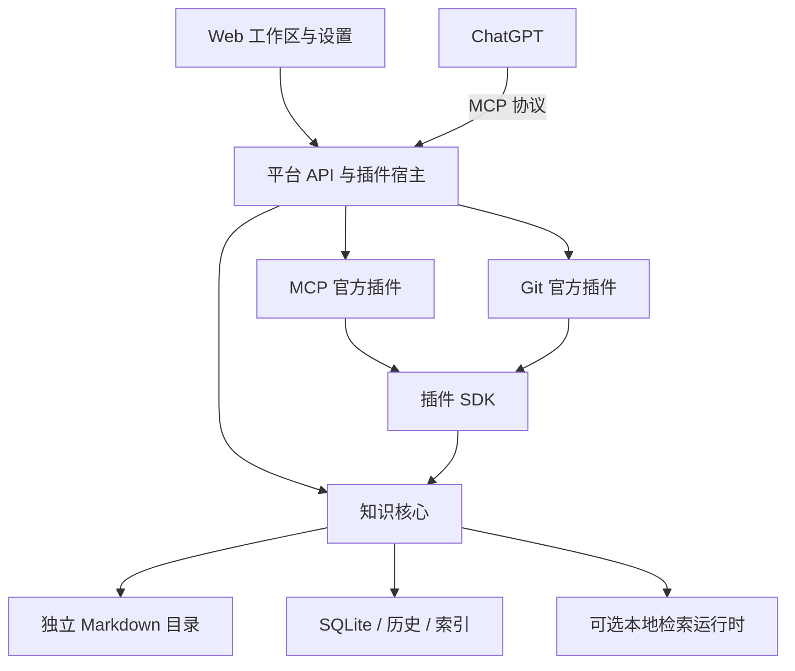

# DooKnow

**面向个人与 AI 协作的 Markdown 知识平台。**

用浏览器整理、阅读和编辑自己的资料，让 ChatGPT 在授权范围内检索和维护知识。Markdown 原文保存在你选择的服务器目录中，MCP、Git 和本地检索按需启用。

DooKnow 将原有 Web 工作区与 `doo-know-bridge` 的 MCP 能力统一到一个平台。新安装通过官方插件提供 MCP 服务，无需另外部署旧 Bridge；知识库原文与平台源码仍分别保存、独立管理。

[安装](#安装) · [官方插件](#官方插件) · [日常管理](#日常管理) · [开发](#开发) · [文档](#文档)

## 可以做什么

| 能力               | 使用方式                                                                        |
| ------------------ | ------------------------------------------------------------------------------- |
| 管理 Markdown 资料 | 浏览目录、创建笔记、编辑、预览和分屏阅读，支持桌面和手机浏览器                  |
| 保留修改记录       | 查看笔记历史、恢复版本和回收站内容；外部修改发生冲突时保留草稿并提示核对        |
| 阅读大文件         | 分页读取与片段编辑，避免一次加载整篇大文档                                      |
| 分享单篇笔记       | 分享最新已保存内容，管理分享入口与附件访问                                      |
| 连接 ChatGPT       | 安装 MCP 插件，配置连接、授权范围，查看客户端及调用状态                         |
| 管理 Git 版本      | 安装 Git 插件，在工作区查看文件状态、提交历史、差异，恢复单篇笔记或提交全部变更 |
| 使用本地检索       | 按需准备检索运行时和模型，下载完成后离线运行                                    |

笔记通过保存按钮或 `Ctrl/Cmd + S` 写回原文，正文默认不自动保存。浏览与编辑不依赖模型下载成功。

## 安装

源码与发行包已公开，安装、官方插件和本地检索包下载均无需 GitHub Token。

```bash
curl -fsSL 'https://raw.githubusercontent.com/bandoo-2001/doo-know/txj/doo-know-platform/deploy/github-install.sh' | bash
```

```bash
wget -qO- 'https://raw.githubusercontent.com/bandoo-2001/doo-know/txj/doo-know-platform/deploy/github-install.sh' | bash
```

安装器下载固定版本并校验SHA-256，内含Node与生产依赖，无需Docker、全局Node/Python、npm编译或sudo。Linux x86_64、glibc ≥ 2.34，需要可用的systemd用户会话。初始账号在终端设置，登录后自己选择知识库目录及插件。完整参数及可选私有分发见[GitHub安装说明](docs/私有GitHub安装与发布.md)。

### 运行要求

| 项目     | 首版支持                                                 |
| -------- | -------------------------------------------------------- |
| 系统     | Linux x86_64，glibc ≥ 2.34；验收 Ubuntu 22.04、Debian 12 |
| 运行用户 | 普通用户，默认安装 systemd 用户服务                      |
| 下载工具 | curl 或 wget                                             |
| Git 插件 | 另外需要系统 Git ≥ 2.39                                  |

默认监听 `127.0.0.1:5173`，端口占用时停止安装。远程访问需要显式配置监听地址、访问来源或反向代理；标准 OAuth 还需要浏览器可达的 HTTPS 地址。用户服务未启用 linger 时，安装器会说明登录会话限制。

### 首次使用

1. 在安装终端设置用户名和非空密码，两次输入确认。输入有误会重新提示，密码不会显示；Web 不开放注册。
2. 打开安装器输出的地址，登录主人账号。
3. **创建新知识库**：只填名称，由 DooKnow 在允许范围内准备保存位置；也可以**使用已有资料**，通过文件夹浏览器选择部署设备上的目录。高级设置保留完整路径和时区选择，时区自动推荐。
4. 按用途选择“让 ChatGPT 使用你的资料”“记录文件版本”“搜索资料内容”，也可以全部跳过，之后在设置中添加。
5. 创建第一篇笔记、导入 Markdown 文件，或直接进入工作区。首次导入支持单个不超过 256 KiB 的 UTF-8 Markdown 文件，保存到 `40-Resources`，不覆盖同名资料；图片和附件不随正文导入。

新建知识库不会预建分类。首次主动导入文件时才按需创建 `40-Resources`。默认保存位置为用户主目录下的 `workspace/knowledge/<知识库名称>`；自定义允许目录时使用其下的同名文件夹。已有目录中的文件不会被移动或清空。

首版为一个主人账号、一个知识库。目录绑定会检查访问边界与真实路径，知识库应与程序、数据库和密钥目录分开保存。

无交互终端时不会创建空密码账号，安装器会给出在本机终端继续初始化的命令。重复安装保留已有账号、配置和数据。代理网络、自有受控制品源及完整安装参数见[安装与恢复文档](docs/原生安装与恢复.md)。

## 官方插件

插件从平台的官方目录安装，拥有独立版本、配置和运行状态。启用后，工作区按需加载插件提供的设置页、文件标记、操作按钮和面板；停用时撤销对应入口。安装新插件无需重新构建主程序。

### MCP：让 ChatGPT 使用知识库

MCP 插件承接旧 `doo-know-bridge` 的工具能力，通过平台 SDK 读取和维护笔记，共用笔记身份、版本检查、历史及幂等写入机制。

- 提供标准 OAuth 授权和独立的 Tunnel Bearer 兼容连接方式。
- 默认只读，由主人决定写权限、目录范围及是否允许索引维护。
- 在设置页查看连接条件、授权客户端、健康状态和调用记录，随时撤销连接。
- 调用记录默认只保存主体、工具、耗时及结果等信息，不保存查询、正文或令牌。

OAuth 与 Tunnel 使用独立认证；选择 Tunnel 时仍需配置相应传输客户端。未配置可访问的外部网页地址时，不会向 ChatGPT 返回 localhost 资料链接。

现有 Tunnel 链路已通过真实调用验收；标准 ChatGPT OAuth 的实际客户端授权仍待完成，协议测试不代替客户端验收。既有 Bridge 的配置接管与验证情况见[平台交付记录](docs/平台交付验证.md)。

### Git：在工作区管理资料版本

Git 插件将版本操作放到浏览资料的上下文中：文件列表显示状态，笔记中查看历史和差异，知识库入口预览并提交全部变更。

- 未建立仓库时可显式初始化，作者信息在插件中配置。
- 仓库顶层必须等于知识库根目录，不修改全局 Git 配置。
- 单篇 Markdown 恢复经过平台保存流程，保留笔记 ID、历史和索引关联。
- 全量提交先预览、后确认；包含新增、修改和删除，部分暂存文件采用当前工作树的完整版本。确认前文件发生变化会要求重新预览。

首版提供本地版本管理，不包含 push、整库 reset 或自动解冲突。缺少系统 Git 时会显示依赖未就绪，不影响平台其他功能。

### 插件扩展方式

宿主提供导航、设置页、文件标记、笔记操作、笔记面板和知识库操作六个扩展点。具体交互组件随插件发布，通用配置由 schema 描述，复杂配置由插件页面提供。

首版只接受可信官方插件，插件运行于主服务进程；SDK 划分维护职责，不提供任意代码的安全沙箱。第三方任意代码市场留待后续版本。[插件 API 与开发合同](docs/plugin-api.md)

## 本地检索

在设置中选择“准备本地检索”，平台会下载并校验固定的 CPython、CPU 依赖和 `bge-small-zh-v1.5` 模型，展示下载、环境准备、启动和失败状态，支持重试与取消。准备完成后可离线运行。

设置页分别展示文本与向量组件的就绪状态；组件暂时不可用时保留已有索引，明确说明当前可用的检索能力。

## 日常管理

安装后使用 `dooknow` 管理服务：

| 操作             | 命令                                                         |
| ---------------- | ------------------------------------------------------------ |
| 查看状态         | `dooknow status`                                             |
| 环境诊断         | `dooknow doctor`                                             |
| 启动、停止、重启 | `dooknow start` / `dooknow stop` / `dooknow restart`         |
| 重置密码         | `dooknow reset-password`                                     |
| 加密备份         | `dooknow backup --destination '/受控目录/knowledge.dooknow'` |
| 回退版本         | `dooknow rollback`                                           |
| 卸载程序         | `dooknow uninstall`                                          |

使用 `dooknow update` 升级到最新正式版本；预发布版本需要显式指定，例如 `dooknow update --version 1.1.0-rc.5`。升级执行下载校验、自检、一致性备份、迁移和健康检查，保留上一版本。卸载默认保留知识库、数据与配置。

新安装遵循 XDG 目录约定：

| 内容                             | 默认位置                                |
| -------------------------------- | --------------------------------------- |
| 管理命令                         | `~/.local/bin/dooknow`                  |
| 配置与受控密钥                   | `~/.config/doo-know/`                   |
| 发行版本、插件、数据、模型与备份 | `~/.local/share/doo-know/` 下分别保存   |
| 下载缓存                         | `~/.cache/doo-know/`                    |
| 服务日志                         | `journalctl --user -u doo-know.service` |

Markdown 原文始终位于自己绑定的目录。加密备份包含原文、回收站、SQLite 一致性副本、历史及必要配置；恢复私钥需要单独受控保存。备份、空目录恢复、升级回退和旧部署接管详见[原生安装与恢复](docs/原生安装与恢复.md)。

## 架构

平台管理账号、文件边界、笔记身份、历史、检索与插件生命周期；插件通过 SDK 使用核心能力，提供协议适配和专属交互。



技术栈：Vue 3、Naive UI、CodeMirror、Fastify、Better Auth、SQLite 和 TypeScript。

```text
doo-know/
├── apps/
│   ├── server/              # 启动、认证、控制面、固定 API 与插件宿主
│   └── web/                 # 工作区、设置与扩展容器
├── packages/
│   ├── core/                # 原文、身份、历史、文件任务与检索
│   ├── plugin-contracts/    # 清单、配置、贡献和状态类型
│   ├── plugin-sdk/          # 服务端能力
│   └── plugin-ui/           # 浏览器能力与共享组件
├── plugins/
│   ├── mcp/                 # MCP 官方插件
│   └── git/                 # Git 官方插件
├── runtime/vector-service/  # 可选本地检索运行源码
├── deploy/                  # 安装器与部署模板
├── scripts/                 # 开发、构建、发布与管理工具
└── docs/                    # 使用、接口与交付记录
```

## 开发

开发环境需要 Node.js ≥ 22.22.1。使用锁定依赖和独立示例库：

```bash
npm ci
npm run demo
npm run account -- init
npm run dev
```

在本机终端创建示例库账号后，访问 `http://127.0.0.1:5173`。示例资料默认位于 `~/.local/share/doo-know-web-demo`；开发 API 默认使用 `3010`，Vite 使用 `5173`，代理与 API 端口须保持一致。开发环境应与正式服务隔离资料、数据库、端口和密钥。

```bash
npm test
npm run test:e2e
npm run typecheck
npm run build
```

构建输出 `dist/web` 和 `dist/server`，原生管理入口为 `dist/server/scripts/manage.js`。检索回归另需独立 Python 环境与固定模型，离线制品测试通过 `DOOKNOW_SEARCH_ARTIFACT` 指定。插件构建、私有制品发布与客户端验收要求见下方文档。

## 文档

| 文档                                                   | 内容                                             |
| ------------------------------------------------------ | ------------------------------------------------ |
| [私有 GitHub 安装与发布](docs/私有GitHub安装与发布.md) | 下载凭据、curl/wget、代理、插件下载和开发者发布  |
| [原生安装与恢复](docs/原生安装与恢复.md)               | 安装参数、服务、升级、加密备份、恢复和旧环境接管 |
| [插件 API](docs/plugin-api.md)                         | 插件包、配置、生命周期、扩展点及 SDK             |
| [机器 API](docs/机器API.md)                            | 保留的机器接口、权限和调用契约                   |
| [MCP 与索引运维](docs/MCP与索引运维.md)                | 索引状态、任务和故障处理                         |
| [平台交付验证](docs/平台交付验证.md)                   | 实际制品、测试结果、迁移证据和待完成的外部验收   |

当前边界为单主人、单知识库和官方插件。多用户协作、定期总结、第三方任意代码市场及跨平台安装尚未包含在首版中。
