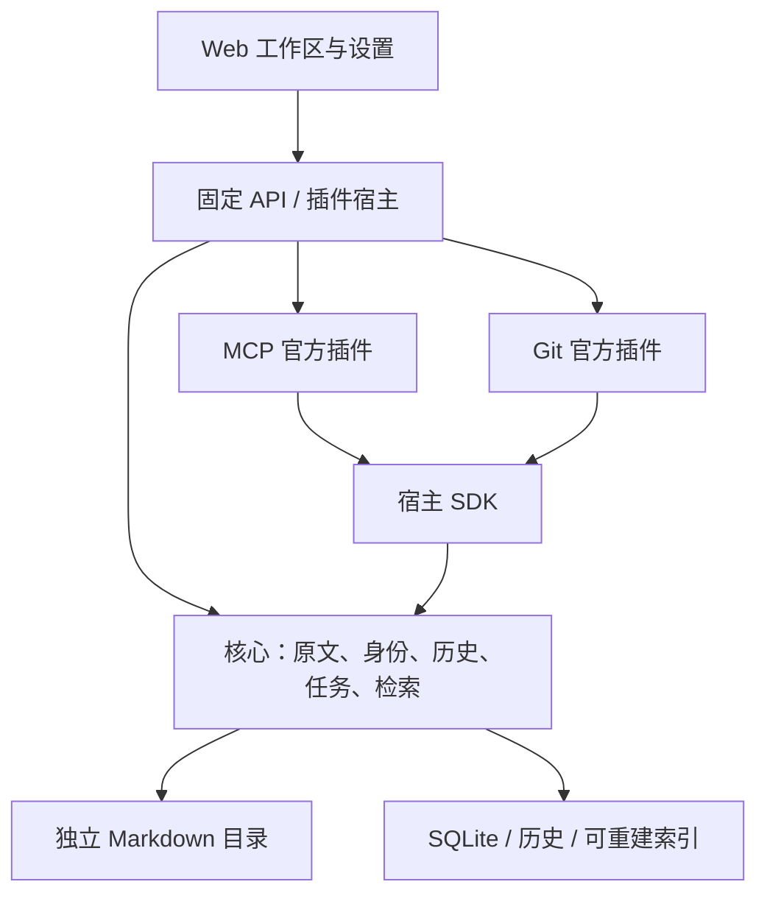

# DooKnow

个人 Markdown 知识平台。Vue、Naive UI、CodeMirror 提供工作区，Fastify、Better Auth、SQLite 管理账号、笔记身份、历史、回收站和检索。Markdown 原文独立保存在主人选择的服务器目录中。

MCP 与 Git 是独立发布的官方插件：安装后动态登记设置页、文件标记、笔记操作和面板，无需重新构建宿主。首版一个主人、一个知识库；浏览与编辑不依赖模型下载成功。

## 安装

```bash
curl -fsSL '<受控安装源>/install.sh' | bash
# 或 wget -qO- '<受控安装源>/install.sh' | bash
```

首版支持 Linux x86_64、glibc、systemd 用户服务，验收 Ubuntu 22.04+、Debian 12+。发行包自带固定 Node 和生产依赖，无需 Docker、全局 Node/Python、编译器或 sudo。源码和制品继续私有，`<受控安装源>` 必须使用实际配置的制品地址。

安装时输入初始用户名与隐藏密码。登录后选择服务器知识库目录和时区，再按需安装 MCP、Git 或准备本地检索。默认只监听 `127.0.0.1:5173`；不会自动生成资料分类或启用外部连接。

```bash
dooknow status
dooknow doctor
dooknow start                 # stop / restart
dooknow update               # rollback
dooknow backup --destination '/受控目录/knowledge.dooknow'
dooknow reset-password
```

完整目录、安装参数、加密备份、空目录恢复、升级与卸载说明见[原生安装与恢复](docs/原生安装与恢复.md)。真实环境接管见[平台交付验证](docs/平台交付验证.md)，历史部署信息见[本机发布](docs/本机发布.md)；开发代码使用隔离 worktree，不直接作为常驻发行目录。

## 工作区与插件

- 浏览、搜索、编辑、预览和分屏；保存按钮或 Ctrl/Cmd+S 写回原文。外部修改导致版本冲突时保留草稿并提示核对。
- 历史、回收站、分页大文件阅读与片段编辑。恢复保留笔记 ID，引用、索引和历史继续关联；正文默认不自动保存。
- 分享读取最新已保存正文；附件验证类型、大小和实际引用，公开入口不提供私人目录与历史。
- MCP 插件提供 ChatGPT 工具、OAuth 授权、独立 Tunnel Bearer 兼容入口、客户端撤销及调用观察。写权限和目录范围由主人配置；调用记录默认不含查询、正文或令牌。
- Git 插件提供文件状态、分页历史、受限差异、保留笔记身份的单文件恢复，以及全量提交预览与确认。需要系统 Git ≥ 2.39，不自动安装依赖；不提供 push 或整库 reset。
- 本地检索按需下载校验固定 CPython、CPU wheelhouse 和模型，在最终路径创建环境，完成后离线运行。就绪状态明确区分 tokenizer 与向量组件，保留 strict/semantic 请求要求。

首版只接受可信官方插件，同进程 SDK 是职责边界，不能隔离任意第三方代码。任意代码市场、多用户、定期总结、自动推送和跨平台安装留待后续版本。

## 源码结构

```text
doo-know/
├── apps/server/              # 认证、控制面、固定路由、生命周期与发行运维
├── apps/web/                 # 工作区、设置和动态扩展容器
├── packages/core/            # 原文、权限、身份、历史、文件任务与检索
├── packages/plugin-contracts/
├── packages/plugin-sdk/
├── packages/plugin-ui/
├── plugins/mcp/              # 独立服务端与浏览器插件包
├── plugins/git/
└── runtime/vector-service/   # 可选本地检索的运行源码
```



[插件 API](docs/plugin-api.md)说明清单、配置 schema、六个扩展点和固定调用入口。插件资源带版本/hash，Vue 和 UI SDK 由宿主共享。插件配置在服务端校验，敏感值保存在受控文件中，浏览器只获得配置状态。

## 开发与验证

开发 Node.js ≥ 22.22.1，使用锁定依赖和独立资料目录、数据库、端口及密钥。检索回归还需独立 Python 环境和固定模型；普通编辑不依赖检索组件，实际离线制品测试通过 `DOOKNOW_SEARCH_ARTIFACT` 显式指定受校验制品。

```bash
npm ci
npm run demo
npm run account -- init       # 本机终端输入示例库账号
npm run dev                  # 独立 API 与 Vite，勿与正式端口冲突
npm test
npm run test:e2e
npm run typecheck
npm run build
```

构建输出 `dist/web` 和 `dist/server`；管理入口固定为 `dist/server/scripts/manage.js`。生产由 Fastify 提供编译资源，不能暴露源码、数据库或原文目录。浏览器测试使用 4179/4180 的临时库；本机已有浏览器依赖通过忽略的 `.local/browser-deps/` 加载，不自动安装系统包。

传统机器 API 与既有笔记、文件、分享接口继续保留。契约和恢复背景见[机器 API](docs/机器API.md)、[索引运维](docs/MCP与索引运维.md)、[检索实测](docs/MCP性能评测.md)。[平台计划](docs/superpowers/plans/2026-10-15-doo-know-platform.md)记录交付范围；当前[平台交付验证](docs/平台交付验证.md)记录测试、制品和真实切换证据，不沿用历史验收结论。

标准 ChatGPT OAuth 需要浏览器可达的 HTTPS 授权站点和 MCP 地址；未配置时插件显示连接条件未满足，知识库仍可使用。本地协议测试不能代替真实客户端接入验收。
