# To Doo 统一 UI 设计图册

开发规范、功能覆盖、实际进度与验收证据统一记录在 [IMPLEMENTATION.md](IMPLEMENTATION.md)。本图册仍是视觉参考，不能替代真实完成状态。

使用内置 **GPT Image** 生成，共15组：13个桌面主页面/视图、1组关键编辑面板（6种）、1组手机适配（4种）。以下链接仅指向最终校正版。

统一沿用原先的窄侧栏主菜单：图标在上、短标签在下，当前页淡蓝选中；内容采用白色、浅灰、蓝色主操作和轻量分隔。手机沿用底部导航。

这些是界面设计稿与示例数据，不是已部署页面或真实专注记录。长期专注项目、完整历史分页与累计统计，以及新分区/抽屉等交互，需要在后续实现中补齐；图中主要数据来自现有任务、清单、时间安排、专注会话、数量打卡、纪念日、复盘和提醒模型。

## 页面索引

| 编号 | 页面 | 重点 |
| --- | --- | --- |
| 01 | [任务列表与详情](01-tasks-detail.png) | 列表与文档式任务详情，阅读态不常驻保存按钮。 |
| 02 | [任务看板](02-board-v2.png) | 任务按状态分列，计划、截止与明确优先级分别标注。 |
| 03 | [目标总览](03-goals-v2.png) | 目标按任务完成项数计算进度，普通清单单独呈现。 |
| 04 | [日历周视图](04-calendar-week.png) | 周视图按时间安排，截止标记不占用时间块。 |
| 05 | [日历月视图](05-calendar-month-v2.png) | 月视图按日期浏览，繁忙日保留更多入口。 |
| 06 | [时间线](06-timeline-v3.png) | 按天横向查看计划，任务名称固定，日期连续排列。 |
| 07 | [四象限](07-matrix-v2.png) | 重要/紧急决定象限，优先级为独立可选属性。 |
| 08 | [专注项目与历史](08-focus-history.png) | 长期专注项目、今日/累计统计、历史时间线和底部计时条。 |
| 09 | [习惯记录](09-habits.png) | 今日数量记录优先，日数量与周/月累计分开。 |
| 10 | [纪念日](10-anniversaries-v2.png) | 近期与远期分层，农历原日期与公历下一次日期分开。 |
| 11 | [统计与复盘](11-review-stats-v2.png) | 区间统计、完成趋势、累计目标进展与复盘记录。 |
| 12 | [通知与提醒](12-notifications.png) | 未读与已处理区分，来源入口、稍后提醒与历史分层。 |
| 13 | [设置](13-settings-v2.png) | 偏好、提醒与连接、数据与恢复、清单管理按页内分类。 |
| 14 | [关键创建与编辑状态](14-key-editors-v3.png) | 新建任务、习惯、纪念日、时间安排、成果笔记、复盘六种编辑面板。 |
| 15 | [手机关键页面](15-mobile-v2.png) | 任务、日历、专注、习惯四种手机布局；使用既有底部简约导航。 |

## 统一功能约定

- 计划与截止分别表达；未来或今天的截止不冒充已逾期。
- 优先级与重要/紧急归类独立；默认无优先级和空资料数不额外占据视觉位置。
- 专注历史使用时钟标记，不使用任务完成勾选。项目归档保留记录，今日与累计统计区分范围。
- 习惯以数量记录，日数量与周期达标分开；周/月达标不表示每天都记录过。
- 农历原日期与换算后公历日期明确区分。示例农历2027年八月十五换算为2027-09-15，距2026-10-30为320天，已用项目现有农历库核对。
- 表单仍是显式保存；关联来源固定的成果笔记不提供误导性的解除关联入口。

## 生成记录

工具：内置 GPT Image，未使用 CLI/API Key。样式参考当前项目的轻量侧栏实际截图；新专注结构参考用户提供的专注项目/历史记录布局。

[最终图片清单](selected-images.json) · [完整提示词与校正记录](generation-prompts-final.json) · [初始批次提示词](generation-prompts.json)

目录中的不带校正后缀旧图是生成过程留存；以本图册及最终图片清单中的文件为准。

## 完整效果

### 01 · 任务列表与详情

列表与文档式任务详情，阅读态不常驻保存按钮。

### 02 · 任务看板

任务按状态分列，计划、截止与明确优先级分别标注。

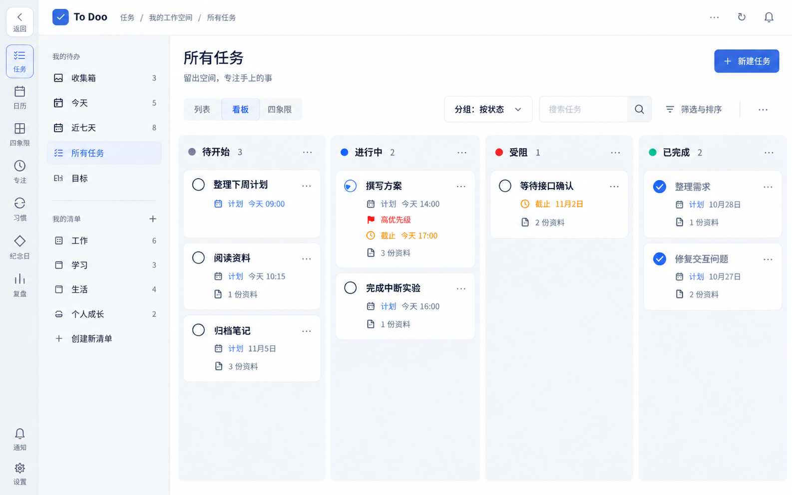

### 03 · 目标总览

目标按任务完成项数计算进度，普通清单单独呈现。

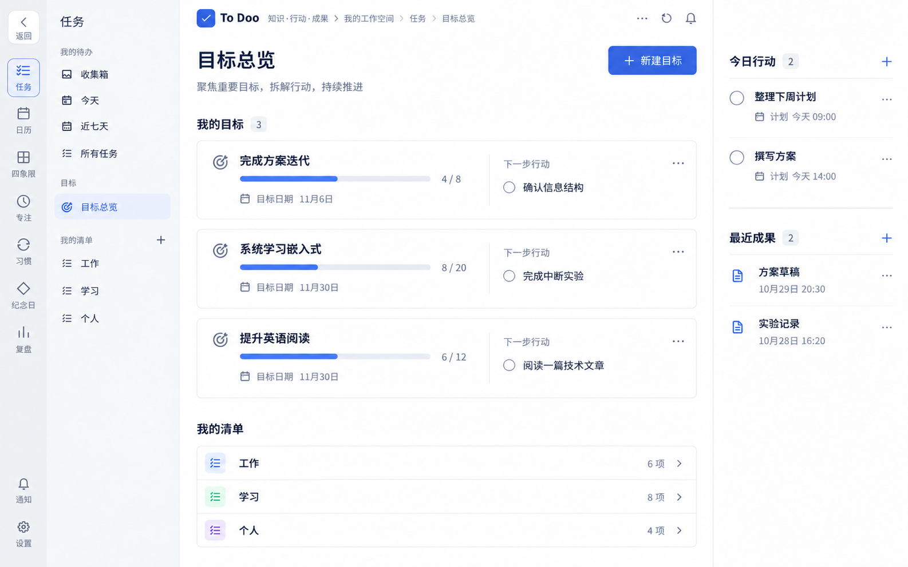

### 04 · 日历周视图

周视图按时间安排，截止标记不占用时间块。

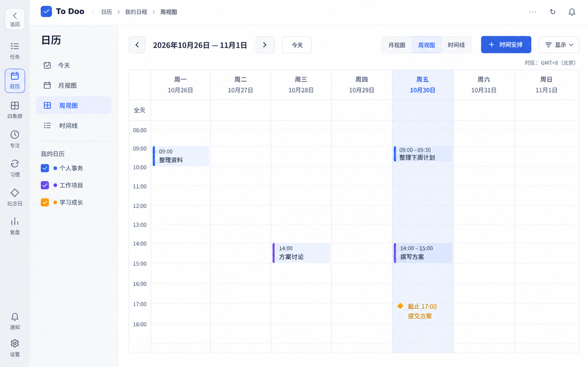

### 05 · 日历月视图

月视图按日期浏览，繁忙日保留更多入口。

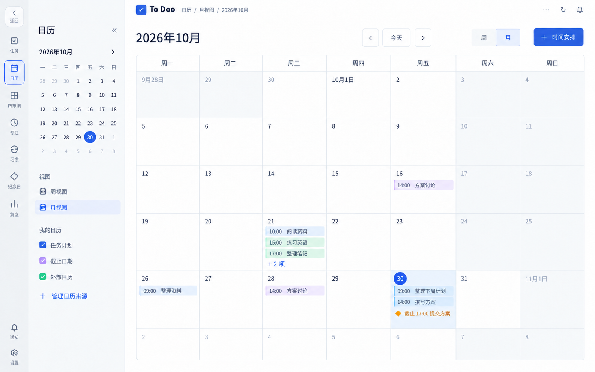

### 06 · 时间线

按天横向查看计划，任务名称固定，日期连续排列。

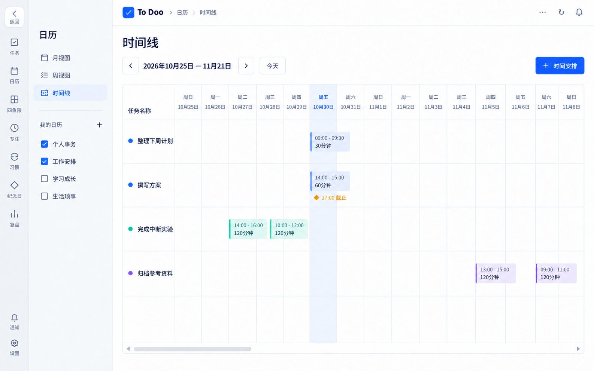

### 07 · 四象限

重要/紧急决定象限，优先级为独立可选属性。

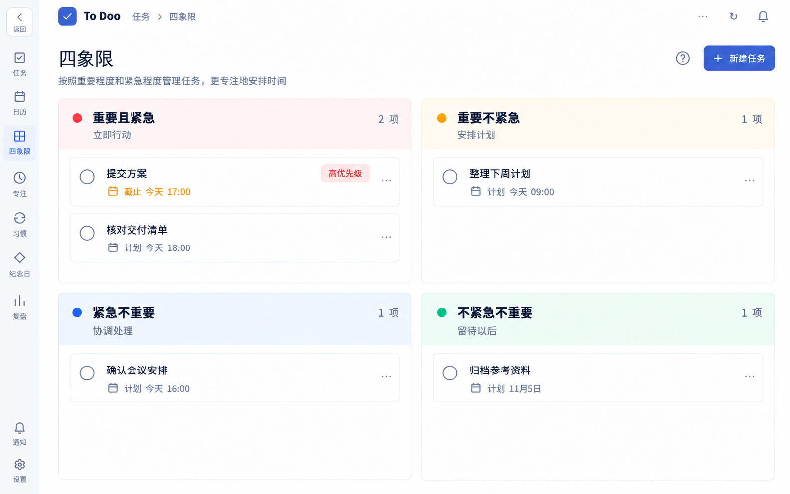

### 08 · 专注项目与历史

长期专注项目、今日/累计统计、历史时间线和底部计时条。

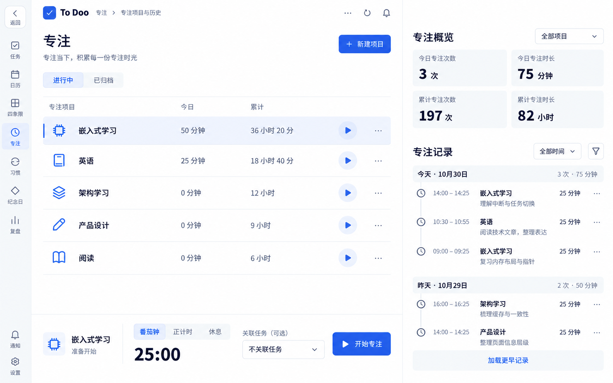

### 09 · 习惯记录

今日数量记录优先，日数量与周/月累计分开。

### 10 · 纪念日

近期与远期分层，农历原日期与公历下一次日期分开。

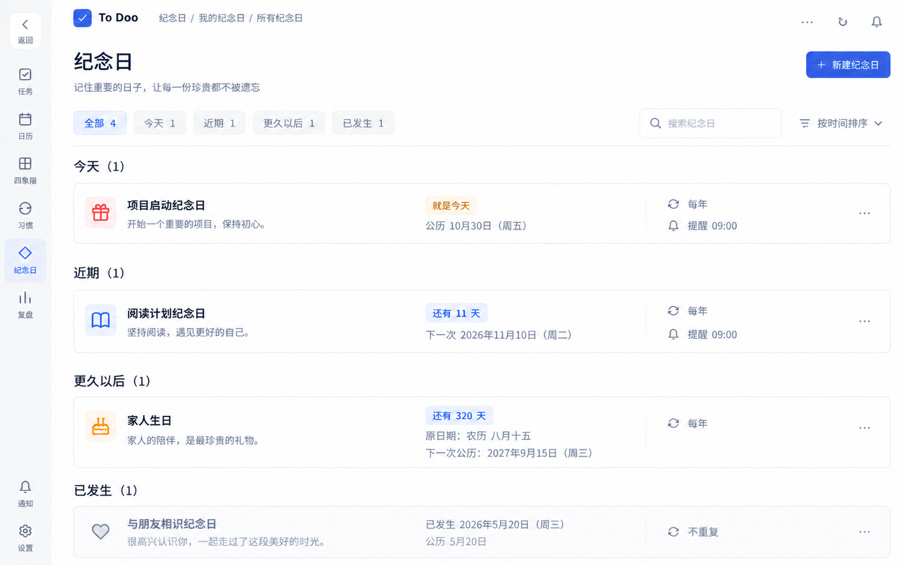

### 11 · 统计与复盘

区间统计、完成趋势、累计目标进展与复盘记录。

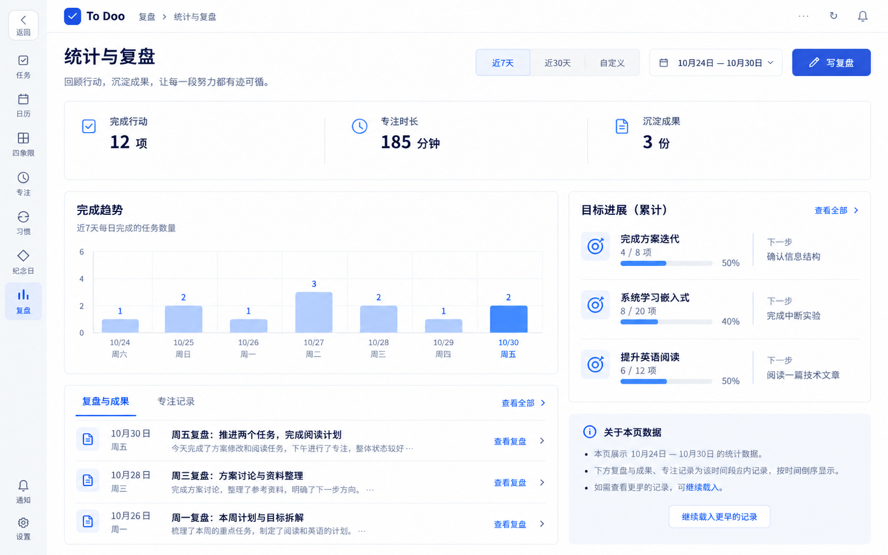

### 12 · 通知与提醒

未读与已处理区分，来源入口、稍后提醒与历史分层。

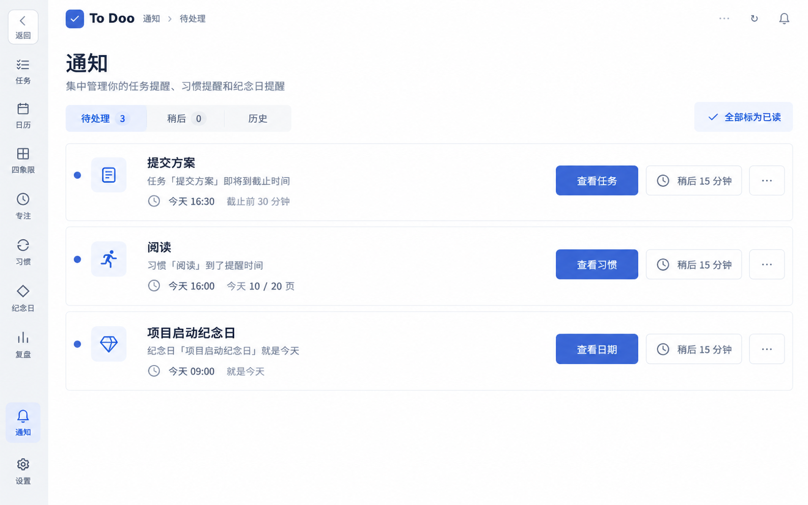

### 13 · 设置

偏好、提醒与连接、数据与恢复、清单管理按页内分类。

### 14 · 关键创建与编辑状态

新建任务、习惯、纪念日、时间安排、成果笔记、复盘六种编辑面板。

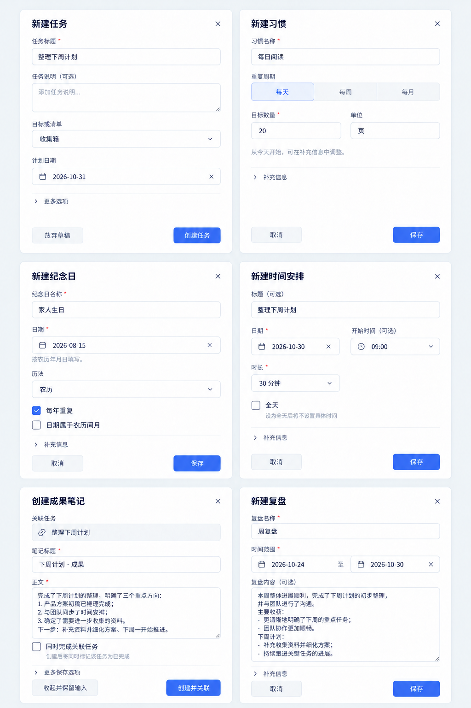

### 15 · 手机关键页面

任务、日历、专注、习惯四种手机布局；使用既有底部简约导航。

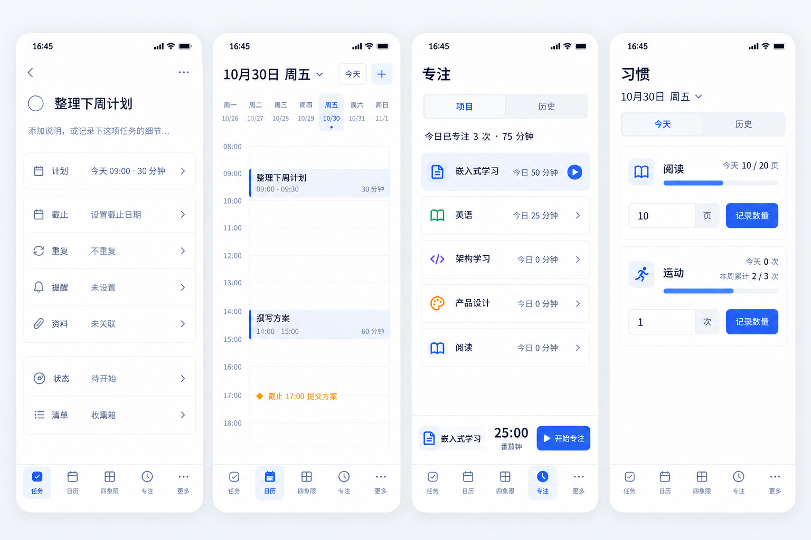

