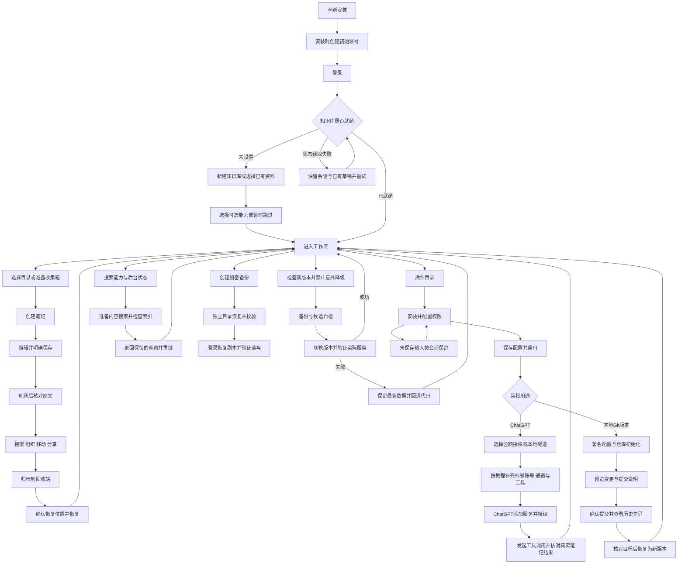

# DooKnow 平台任务链路优化设计

## 用户目标与授权

面向不懂 MCP/OAuth/Tunnel/Git 的个人知识库用户，从安装、账号准备、空库到各项任务结果都有清晰入口、真实状态、下一步及失败恢复。用户要求深度审查整个平台、落实 UX/UI 与功能测试，并完成新版本正式发布上线；只有重大范围分歧、不确定生产数据破坏或账号凭据需求才集中确认。例行设计与实现直接推进，不重复审批。

## 当前证据与交付范围

生产服务固定运行 rc.19，源码开发服务独立；当前工作区有未提交的目录选择、收藏/最近、树操作、状态抽屉和样式工作，必须保留并纳入验证。初始基线类型检查通过；默认 /tmp 写入返回 -122，测试改用独立 /var/tmp/dooknow-platform-ux，不清理他人缓存。

本次必须交付：

1. 登录后平台状态加载失败可重试、可退出，不出现空白页；空库与现有资料链路均验收。
2. 插件配置按任务分组、模式决定相关字段、统一排版，保存/启用/离开时明确状态；允许访问目录使用可理解的输入方式，不强迫用户写 JSON。
3. 启用前可阅读 ChatGPT 连接教程，按公网 HTTPS 与本地隧道分支说明准备、安装位置、实际字段与测试；连接状态准确区分保存、本地准备、外部连通未验证、成功工具调用。教程官方来源与日期可见，不能假称自动配置外部账号。
4. Git 提交预览必须对应最终说明与文件；查看差异与恢复对象一致，异步切换不能混用旧差异。
5. 在线更新禁止无意降级，显式回滚独立保留；版本发布与公开安装入口同步，避免本机更新回旧版本。
6. 覆盖笔记编辑保存/移动/删除恢复、分享、导入导出、索引准备与失败、加密备份独立恢复、账户会话、插件启停、更新的现有功能；发现阻断补修，未证实功能不宣称可用。
7. 正式源码构建、版本制品、隔离安装/重启/恢复、桌面手机测试、生产升级与冒烟、回滚入口及发布说明。

适合追加：设置页任务导航与搜索失败到搜索设置的直接入口、无账号安装帮助、插件配置离开保护；以审查与测试发现为依据。

暂缓：替换技术栈、多用户协作、任意第三方插件市场、全自动申请域名或接管用户 OpenAI 账号。它们不属于本次可验证链路；现有人工准备步骤应完整引导。

## 设计规则

- 复用现有 Vue/Ant Design 控件及样式变量，常规表单标签上置、说明下置，长地址与目录输入整行，开关独立成组。移动端一列；不横向溢出。
- 插件宿主仍从可信目录安装，不扩大代码加载权限。MCP 教程作为宿主静态组件，在未启用插件时也可访问；运行状态仍由受认证接口提供。
- OAuth/本地隧道显示中文名称与对应解释。只有本地隧道/同时启用显示兼容端口和密钥；不会因隐藏字段而自动清空既有值。
- 默认只读，说明写入影响。目录策略必须保留原校验边界，不扩大实际权限。教程与实际按钮、端点一致。
- “服务已准备”仅表示服务器检查；公网可达性、隧道在线和 ChatGPT 端操作无法证实时明确待验证。工具成功记录标为最近调用，不保证当前通道仍然在线。
- 不引入数据库格式变更；如后续不可避免，先更新迁移/恢复设计。

## 验收路径

| 任务 | 起点和节点 | 结果与恢复证据 |
| --- | --- | --- |
| 新安装 | 原生安装→创建初始账号→登录→新建/绑定空库→跳过或配置可选能力 | 第一篇笔记、文件夹与子笔记持久保存；刷新续接 |
| 笔记管理 | 目录→新建→编辑→保存→查找→移动→分享→归档→恢复 | 浏览器与真实文件/身份一致；冲突、失败留草稿 |
| 插件 | 空列表→可信目录→安装→配置→保存→启用→贡献加载→停用 | 未启用可读教程；失败可重试；不丢字段 |
| ChatGPT | 选择通道→准备账号/工具→本地配置→外部平台创建→授权→工具调用 | 每步状态可解释；真实外部接入单独记录，不能以模拟替代 |
| Git | 安装→作者配置→启用→初始化→变更→预览→确认→历史/差异→恢复 | 预览后变更重新预览；异步查看无版本错配 |
| 搜索 | 无组件→文件名查找→准备内容搜索→索引→查询 | 无结果/能力不足可区别；下载与失败有恢复入口 |
| 数据保护 | 创建加密备份→下载→独立恢复→完整性检查→登录读取/编辑 | 原数据未覆盖；恢复撤销旧授权 |
| 升级 | 当前版→检查新版本→备份→候选准备→升级→健康/版本/功能核对 | 默认不降级；候选失败回退；人工回滚保留最新数据 |

逐条证据记在本次验收记录，区分自动化、浏览器实际操作、真实外部服务与未验证项。完整目标在证据齐全及实际新版本上线前保持进行中。

## 用户任务链路图

外部账号、隧道和ChatGPT授权必须由有权限的使用者完成；教程、协议测试与真实外部调用分别计证据。每条操作遇到结果未知时先核对原请求，不能通过更换请求ID盲重试来推进流程。
