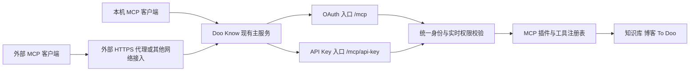

# 通用 MCP API 服务改进方案

日期：2026-11-01（Asia/Shanghai）。状态：评审草案，尚未实施。

用户已确定的方向：提供通用 MCP API 服务；移除产品内部的 Tunnel 实现与专用配置，网络接入交给外部；密钥支持指定到期时间或永不过期。

本方案建议保留现有 OAuth，同时新增多个客户端各自独立的 API Key。协议、业务工具和权限引擎继续复用。下文的路径、默认有效期、轮换规则及迁移方式是设计建议，供实施前评审。

## 1 目标与边界

提供一个由 Doo Know 宿主管理、MCP 插件提供工具的标准 Streamable HTTP 服务。外部客户端可以通过 OAuth 授权，或者通过支持自定义 Authorization 请求头的客户端使用 API Key。

产品负责协议处理、认证、客户端授权、有效期、撤销、业务权限和调用记录。外部基础设施负责域名、TLS、反向代理、穿透、网络可达性与其自身的身份校验。外部代理的认证不能替代本服务的凭据验证。

本期完成 API Key 多客户端管理、通用接入、Tunnel 移除和旧连接迁移。继续保留知识库、博客、To Doo 的现有工具契约、资源边界和写入幂等行为。

不增加独立 MCP 守护进程、第二个业务数据库、专用监听端口、通用 REST 工具网关、旧版 HTTP+SSE 传输适配、自动公网探测或任何特定网络产品的安装和保活功能。无需为本次改造迁移主机目录或更改现有服务运行用户。

## 2 当前实现与改动依据

| 当前实现                                                             | 位置                                                   | 对改造的影响                               |
| -------------------------------------------------------------------- | ------------------------------------------------------ | ------------------------------------------ |
| SDK Streamable HTTP，无状态请求，共用工具注册表                      | `plugins/mcp/server/index.ts`                          | 保留协议实现和工具，移除 REST/OpenAPI 分支 |
| 主服务 `/mcp` 接受 OAuth，独立 loopback 端口提供 Tunnel Bearer       | `apps/server/plugins/mcp-transport.ts`                 | 合并到主服务监听器，按入口明确认证方式     |
| 每个 owner 一个 Tunnel 身份，身份与凭据分离                          | `apps/server/platform/tunnel-identity.ts`              | 改为多个 API 客户端，延续稳定身份原则      |
| `authGeneration` 对应的凭据引用必须等于插件 `tunnelToken.$secretRef` | `packages/core/auth/grants.ts`                         | 必须改成通用凭据状态校验，覆盖排队任务     |
| 平台授权表与分域权限交集                                             | `platform_grants`、`packages/core/auth/permissions.ts` | 复用，不建立第二套业务权限表               |
| 修改密码、恢复等操作使远程授权代数变化                               | `packages/core/auth/remote-auth.ts`                    | API Key 必须服从相同失效规则               |
| 连接指南、插件表单、客户端分类使用 `oauth/tunnel/both`               | MCP 前端、manifest、共享连接契约                       | 替换为认证能力开关、API Key 管理与通用状态 |
| 历史 Bridge 接管脚本及测试                                           | `scripts/adopt-bridge.ts`、`bridge-adoption.ts`        | 从新版本运行与发行入口移除，保留历史记录   |

当前工作区存在大量未提交修改，包含 MCP 和公共权限模块。实施时基于这些实际文件协调增量变更，不重置或覆盖既有工作。

## 3 方案比较与推荐

| 方案                             | 收益                                     | 代价与限制                                       |
| -------------------------------- | ---------------------------------------- | ------------------------------------------------ |
| 仅保留 OAuth                     | 认证形式单一，改动较少                   | 不满足方便签发有期限或永久 Token 的诉求          |
| OAuth 加一把全局 API Key         | 能快速替换原 Tunnel 接入                 | 无法独立授权、撤销或区分多个客户端，后续仍要拆分 |
| OAuth 加多个客户端各自的 API Key | 满足有效期、独立权限、独立撤销和审计需求 | 需要密钥表、客户端管理与迁移；业务层无需重做     |

推荐第三种。移除 Tunnel 的方向已经确定；多个客户端及保留 OAuth 是本方案的推荐选择，不能表述为用户已确认的最终实现。

## 4 接入结构

所有入口使用现有主服务端口和生命周期。保持平台的现有绑定方式；部署到本机时优先 loopback。公网开放与反向代理由部署者配置，本次方案不自动修改网络配置或停止已有外部进程。

### 4.1 MCP 路径

| 路径           | 认证                              | 行为                                        |
| -------------- | --------------------------------- | ------------------------------------------- |
| `/mcp`         | 现有 OAuth Access Token           | 保留现有 resource URI、发现、同意和撤销行为 |
| `/mcp/api-key` | `Authorization: Bearer <API Key>` | 新增的 API Key MCP 服务入口                 |

两个入口共用 SDK 传输处理器、工具定义和业务服务；认证入口分开，避免错误凭据触发另一种认证路径。OAuth Token 不作为 API Key 使用，API Key 也不作为 OAuth Token 使用。

API Key 是额外的客户端兼容能力，不声明所有 MCP 客户端都支持。OAuth 保留标准授权路线，实际客户端兼容性以连接验收为准。

### 4.2 协议行为

继续使用无状态 Streamable HTTP 和 SDK 的 JSON 响应模式。POST 处理初始化、协议通知、工具发现和工具调用；初始化通知按协议返回 202。GET 在不提供独立 SSE 监听流时返回 405；无状态服务的 DELETE 返回 405，不能伪造成功关闭会话。OPTIONS 仅服务于经过允许来源检查的预检。

协议版本、Accept、Content-Type 和请求格式校验由共享处理器与 SDK 共同完成，测试覆盖真实 SDK 客户端。保留请求与响应大小、超时、取消和并发预算，不手写一套替代 MCP JSON-RPC 协议。

移除 Tunnel 监听器上的 `/health`、`/openapi.json`、`/api/v1/tools/:tool`。健康信息使用现有平台机制和主人可见的 MCP 状态接口。现有网页 `/api/` 及内部 Agent 接口不属于此次移除范围。

## 5 客户端身份与密钥模型

延续三层分离：客户端是稳定身份；API Key 是可替换的认证凭据；`platform_grants` 保存主人批准的业务权限。

新增的表名与字段是设计草案，具体索引及 schema 版本由实施时确定：

| 数据                   | 核心字段                                                                                             | 约束                                                            |
| ---------------------- | ---------------------------------------------------------------------------------------------------- | --------------------------------------------------------------- |
| `mcp_api_clients`      | `owner_id`、`client_id`、`principal_id`、名称、状态、版本、创建时间                                  | owner 与 client 唯一；身份在换密钥后保持稳定                    |
| `mcp_api_keys`         | Key ID、owner/client 外键、校验摘要、显示尾号、签发时间、到期时间、撤销时间、`auth_generation`、版本 | Key ID 全局唯一；不保存完整 Token；每个客户端最多一把未撤销密钥 |
| 现有 `platform_grants` | grant ID、owner/client、权限、版本、active                                                           | 继续作为授权权威来源                                            |

API 客户端表只保存 API Key 客户端；OAuth 客户端继续由现有 OAuth provider 管理。设置页聚合两者，不建立重复的 OAuth 客户端数据库。类型根据存储关系判断，不靠名字或 ID 前缀猜测。

客户端 owner 来自主人的已登录会话，普通客户端请求根据密钥查找 owner，禁止通过“取第一个 user”或请求体指定 owner 建立身份。所有列表、修改和撤销操作均校验 owner。

API Key 仅使用服务端密码学随机数生成，例如 `dk_mcp_<key-id>.<random-secret>`，secret 至少 32 个随机字节。Key ID 用于有界查找，SHA-256 摘要用于验证完整规范 Token，固定长度摘要采用恒定时间比较。高熵随机凭据不使用用户密码作为密钥。

创建和轮换时只返回一次完整密钥；后续接口只返回名称、Key ID、尾号与状态。响应设置 `Cache-Control: no-store`，Token 不进入 URL、日志、持久前端草稿、浏览器本地存储或错误遥测。

若创建响应丢失，完整密钥不可重新读取；主人可从列表找到该连接并重新轮换。客户端不得自动无限重试签发请求，界面防止重复提交。

## 6 生命周期与有效期

| 操作           | 约定                                                                                |
| -------------- | ----------------------------------------------------------------------------------- |
| 创建           | 设置名称、资源权限和有效期；客户端、密钥、grant 在同一事务内落库                    |
| 有效期         | 7、30、90 天、自定义时间、永不过期；建议默认 90 天                                  |
| 永不过期       | 数据库 `expires_at = NULL`；仍受撤销、插件停用和远程授权失效控制                    |
| 修改名称       | 只改显示信息，不影响授权或 Token                                                    |
| 缩小权限       | 立即更新 grant 版本，后续请求和尚未执行的任务重新核对                               |
| 扩大权限       | 主人明确编辑并保存，受服务权限上限约束；不因插件配置扩大而自动增加                  |
| 轮换密钥       | 保留 owner、principal、client 与已批准权限；同一事务签发新密钥并撤销旧密钥          |
| 密钥到期       | 当 `now >= expires_at` 时拒绝；只改客户端时钟无法延长有效期                         |
| 重新签发       | grant 仍有效且客户端未撤销时，到期或丢失通过轮换签发；首把迁移密钥按凭据版本 0 签发 |
| 重新授权并签发 | 全局授权失效或迁移授权无效时，由主人明确选择权限并完成一次事务；保持原身份          |
| 撤销连接       | 撤销该连接密钥和 grant，版本递增；终止其后续访问                                    |

首版不提供新旧密钥重叠有效期，也不允许直接修改现有 Token 的到期时间。需要延长时通过轮换选择新有效期，避免引入隐藏续期状态。主动撤销的连接需要新建；全局授权失效的客户端需要独立重新授权，均由主人明确操作。

客户端持久状态区分 `active`、`requires_key`、`requires_reauthorization`、`revoked`；密钥自然到期由到期时间计算。迁移后仍有有效 grant 的客户端进入 `requires_key`，只在核验原 grant 后通过主人显式签发首把新密钥解除；密码变更、完整恢复或迁移中失效授权进入 `requires_reauthorization`。`requires_reauthorization` 与 `revoked` 不能通过改名称、普通权限编辑或换密钥解除。

“重新授权并签发”仅允许未主动撤销、处于 `requires_reauthorization` 的客户端使用。主人提交明确选择的权限、有效期以及预期客户端/grant 版本；后端检查当前服务上限后，在同一事务更新原客户端的 grant、使旧密钥失效并签发当前授权代数的新密钥，状态回到 `active`。沿用原 owner/principal/client ID，保持原业务回执归属；不自动沿用或扩大旧授权。版本冲突返回 409。

主动撤销操作必须将客户端标为 `revoked`，全局失效不能覆盖该状态；此类客户端不提供恢复接口，需要新建连接。API Key grant 的其他主动撤销入口也调用同一客户端撤销服务，防止仅改 grant 而丢失撤销原因。重新授权与普通权限保存使用不同服务方法，后者只接受 active grant。

自定义时间在界面显示用户时区和具体到期时刻，后端保存统一的 UTC 时间；后端拒绝已经过去的到期时间。相对 7/30/90 天以服务端签发时刻计算。永不过期需要用户主动选择，不设隐藏的到期时间。

## 7 认证和实时权限

API Key 每次请求检查：服务和 API Key 入口启用、Token 格式、密钥摘要、owner、客户端状态、密钥撤销和到期、远程授权代数、grant 状态与版本，以及当前服务权限上限。

有效权限是已批准授权、服务上限和当前资源状态的交集。知识目录、博客资源、To Doo 清单和子域继续使用现有稳定资源身份及分域权限。新建表单默认只读，不默认授予全库；主人明确选择可访问的资源，后端拒绝超出上限的授权。

权限不复制进一个长期 JWT 中作为唯一依据。API Key 验证通过后产生宿主可信 Principal，至少携带 `credentialKind`、Key ID/凭据引用、凭据版本、owner、principal、client、grant ID/version、签发和到期时间、`authGeneration`。

核心公共校验处将 `tunnelToken.$secretRef` 特判替换为通用的凭据校验：API Key Principal 通过 Key ID、版本和数据库状态验证，OAuth Principal 保留现有签名、audience、grant 与时间校验，旧 Agent assertion 继续使用原验证器。普通请求不能自行构造 `credentialKind` 绕过认证。

异步任务、写入操作执行前、传输分块以及幂等结果重放均需重新检查凭据和授权状态。轮换后的旧 Key ID/version、到期、撤销、密码重置或恢复操作不能因任务已排队而绕过。已提交的写入不会被撤销操作倒退；执行中的不可逆写入以现有事务提交边界为准，不承诺强行中断已提交操作。

插件停用阻止两种入口；重新启用不复活已到期、已撤销或代数失效的凭据。密码变更和恢复沿用 `invalidateRemoteAuth`，并在同一失效事务将未撤销 API 客户端设为 `requires_reauthorization`；永不过期密钥也会失效，必须由主人重新授权并签发。

共享缓存、传输句柄、快照和幂等记录继续按 owner/principal/client 和业务资源隔离。Key ID 不取代稳定 client ID 作为写入回执归属，否则轮换会破坏重试行为。

## 8 管理接口与认证隔离

管理操作沿用主服务的网页登录、owner 校验、Origin 和 CSRF 保护。API Key 只能访问相应 MCP 入口和被授权的业务工具，不能用来签发更多密钥、登录网页或修改服务权限上限。原有经业务授权的 To Doo 设置工具继续服从其自身权限，不等同于宿主认证管理权限。

建议的管理接口形状：

| 接口                                                 | 用途                                                     |
| ---------------------------------------------------- | -------------------------------------------------------- |
| `GET /api/platform/mcp/api-clients`                  | 分页查看客户端、有效权限与密钥摘要状态                   |
| `POST /api/platform/mcp/api-clients`                 | 创建客户端、授权和首把密钥                               |
| `PATCH /api/platform/mcp/api-clients/:id`            | 修改名称；携带版本，避免覆盖他人修改                     |
| `PUT /api/platform/mcp/api-clients/:id/permissions`  | 主人明确保存权限，校验 grant 版本                        |
| `POST /api/platform/mcp/api-clients/:id/rotate-key`  | 按预期凭据版本轮换；只返回一次新 Token                   |
| `POST /api/platform/mcp/api-clients/:id/reauthorize` | 明确重选权限并签发；仅接受待重新授权、未主动撤销的客户端 |
| `POST /api/platform/mcp/api-clients/:id/revoke`      | 撤销连接，重复撤销返回稳定结果                           |

复用现有客户端收窄与撤销服务，按类型分派 OAuth provider 或 API Key store。OAuth 撤销与 API Key 撤销不能误用对方的存储。管理接口不接受密钥摘要或 Token 作为权限配置的一部分。

认证失败对外统一返回 401，避免泄漏某把密钥是否存在或到期；有效身份无资源权限时返回 403。OAuth 保留原发现挑战，API Key 入口使用自身 Bearer challenge，不提示 OAuth 自动回退。版本冲突返回 409，预算超限返回 429，维护状态返回 503。MCP 请求的协议错误形状继续由共享处理器保持一致。

## 9 配置与设置页

用 `oauthEnabled`、`apiKeyEnabled` 两个独立布尔值替换 `mode`。业务权限上限继续保存于现有插件配置；新建 API Key 不把凭据塞回 manifest 配置表单。外部规范地址优先复用宿主 `config.origin`，资料链接复用已有 `externalWebOrigin`，不增加第三个 Tunnel/MCP 专用域名来源。

设置页收敛为三块：

1. 服务连接：启用状态、本机地址、根据宿主规范地址生成的外部地址、OAuth/API Key 开关、所需 Authorization 格式。未配置 HTTPS 时显示本机可用和外部地址未配置，不能声称公网已通。
2. API Key 客户端：名称、可见尾号、权限摘要、有效期、有效/到期/撤销/待重新签发状态、最近认证时间；支持创建、调整权限、轮换和撤销。完整密钥只在签发结果中短暂显示。
3. OAuth 授权连接与调用记录：继续展示授权、当前有效权限、撤销、最近成功工具调用和错误码；不混淆“认证成功”和“工具执行成功”。

删除 Tunnel 端口、Tunnel 地址、Tunnel Bearer、安装与启动指引、专用探测、授权按钮、状态标签和前端条件分支。用户向外部接入服务填写目标 MCP 地址与 Token，由外部服务提供自己的配置界面。

首版仅提供通用 URL 和 Authorization 示例，示例使用 `<API_KEY>` 占位值。具体客户端配置格式留给文档示例按实际客户端验证，不将未验证模板标成一键可用。

## 10 外部接入契约

外部代理应保留目标路径、Authorization、Accept、Content-Type、MCP-Protocol-Version 等协议头，并支持原始 POST/JSON 响应。不要将 MCP POST 重定向到登录 HTML、把 Authorization 放入查询参数，或改写协议正文。API Key 的外部路径可以映射到后端 `/mcp/api-key`，但路径映射由外部配置承担。

宿主继续校验 Host 和存在的 Origin；允许来源来自明确配置，不采用通配符 CORS，也不为便于代理而移除校验。不发送 Origin 的原生客户端仍须通过 Token 验证。只信任明确配置的反向代理地址，不能无条件相信任意 `X-Forwarded-*` 或客户端声称的 IP。

外部 HTTPS 可以在可信反向代理处终止，主机内 loopback 上游可以是 HTTP。OAuth 的规范 resource URI 继续是宿主规范 HTTPS 地址的 `/mcp`；启用 OAuth 时登录、授权、令牌与发现路径也必须可达，不能只转发 `/mcp` 一个路径。具体公开路径依据现有 OAuth 路由核实。

不保证任意名称带 Tunnel 的服务都能转发 MCP。仅支持 OpenAPI/REST 上游的外部工具需要外部适配器，不能把已移除的 `/openapi.json` 当作 MCP 发现入口。本服务只承诺标准 MCP 和明确的认证契约。

连接状态只证明本机处理器是否可用。外部端到端是否成功由实际客户端完成初始化、工具发现和一次允许的工具调用验证；本地绿灯不等于公网已连接。

## 11 调用记录和预算

沿用现有仅记录工具、主体、客户端、时间、耗时、结果码的方式，增加认证类型和非敏感 Key ID 以便区分轮换。禁止记录 Authorization、Token、Cookie、完整请求正文、查询内容或资料正文。

管理动作记录创建、轮换、权限变更、撤销及主人身份，不含密钥摘要和密钥本身。最近使用定义为认证成功；最近成功工具调用单独展示。使用时间可节流更新以减少 SQLite 写入，首版允许最多约一分钟的显示延迟，不能用其决定认证有效性。

协议请求继续使用现有大小、调用超时与业务读取预算；补充认证失败入口限流，并按稳定客户端限制认证后请求。配置由宿主统一管理，不在界面新增一组复杂的配额表单；具体默认值在实现中结合现有预算确定并记录。

## 12 Tunnel 移除与旧数据迁移

本次是有明确接入变更的升级：移除专用监听端口及兼容路径后，原外部连接需要更新后端地址和新 Token。方案不承诺原连接零配置继续可用，也不保留一个长期运行的 Tunnel 兼容层。

一次性迁移仅在平台升级层识别旧配置和表，常态协议层、设置页和插件不再依赖 Tunnel 字段。迁移必须在旧 manifest 校验、新 manifest 激活之前安排顺序，避免 `additionalProperties: false` 导致旧配置被直接拒绝。宿主与官方 MCP 插件按兼容版本成组发布，旧插件不能因缺少 `mcp.compat` 而静默失效。

迁移规则：

1. 升级前使用现有一致性备份机制备份数据库、配置与受控密钥，并记录实际外部上游地址。实施时确认旧专用端口与客户端切换影响，安排短暂的连接维护窗口。
2. 创建新表及迁移版本标记，在事务内将旧 `mode` 映射为能力开关：`oauth` 为 OAuth 开、API Key 关；`tunnel` 为 OAuth 关、API Key 开；`both` 为两者开。新安装建议默认启用 API Key，OAuth 按已有 HTTPS 条件配置，不为迁移更改旧用户原有启用偏好。
3. 仅对已经存在且可验证归属的旧 Tunnel 身份创建 API 客户端元数据，保留 owner、principal ID、client ID、grant ID/version、资源选择绑定与写入回执归属。已有撤销、到期和授权代数失效状态保留，不自动重新授权。
4. 不把旧 Token 转成永久 API Key，也不自动生成完整新密钥供后台保存。原有效 grant 迁为 `requires_key`，显示“待签发密钥”；主人检查权限和有效期后签发首把新密钥。原身份或 grant 明确被主动撤销的迁为 `revoked`；原凭据到期、授权代数失效而未主动撤销的迁为 `requires_reauthorization`。无法可靠区分的无效历史记录按 `revoked` 处理，不默认恢复。没有旧身份或 grant 的配置不得从当前插件上限推导出全权限客户端。
5. 从活动配置中移除 `compatPort`、`tunnelToken`、`tunnelOrigin` 和旧 `mode`，不再读取旧密钥。旧密钥引用及存储删除使用现有 secret 生命周期机制，在迁移成功且回退边界明确后清理。旧表完成映射核验后删除；保留通用迁移回执而不保留运行时分支。
6. 发布新版宿主和插件后，验证新接口和拒绝行为，再由部署者在外部服务中修改上游地址与凭据，完成实际工具调用。外部配置不由应用自动代改。旧 Bridge 接管脚本及其运行依赖从新版发行入口删除。

迁移要求可重入、事务性、状态可核验。崩溃或缺失关联数据时保持接口不可认证并报告待处理，不凭空恢复权限。历史部署和验收记录保留为事实，不将其改写成新版本仍支持 Tunnel。

回退分界：新版本接受业务写入前，可按平台支持的发行回退流程恢复代码和配套迁移前配置/数据库；开始接受新写入后，禁止直接覆盖旧数据库。此时优先修复前进，只有验证数据兼容后才能退代码；API Key 验证摘要无法还原旧 Tunnel Token。正式切换前需验证原系统回退契约及备份恢复，不假定任意旧宿主都兼容新 schema。

## 13 备份与资料导出

客户端、密钥摘要和 grants 属于宿主认证状态，纳入受控完整备份，但不进入 Git、普通知识库导出、可移植资料包或插件配置分享。摘要不是明文 Token，也仍按敏感认证状态保护。

完整恢复必须沿用远程授权失效流程，使恢复前的 API Key 无法复活；恢复后重新授权和签发。普通资料导入不能导入可用客户端或授予权限。测试要区分完整备份恢复和资料导入两条路径。

## 14 代码与文档范围

| 范围                                                                  | 处理                                                                        |
| --------------------------------------------------------------------- | --------------------------------------------------------------------------- |
| `apps/server/plugins/mcp-transport.ts`                                | 主服务注册两种认证入口；移除独立服务器、compat 状态和 Tunnel Host 分支      |
| `apps/server/platform/mcp-api-keys.ts` 等新增模块                     | API 客户端和凭据存储、事务、摘要验证和生命周期                              |
| `apps/server/platform/mcp-management.ts`、`mcp-client-permissions.ts` | API Key 管理；OAuth/API Key 分型；按 owner 聚合与撤销                       |
| `packages/core/auth/grants.ts`、`remote-auth.ts`、Principal 契约      | 通用凭据核对、全局失效和排队任务授权；保留非 MCP 调用者行为                 |
| 平台升级与插件宿主                                                    | 先迁移旧配置再校验新 schema；一致性备份、版本门槛和恢复验证                 |
| `plugins/mcp/server/index.ts`、manifest、web 入口                     | 共用 MCP 处理器，移除 REST/OpenAPI 和 Tunnel 配置；仅重命名本次相关错误类型 |
| `shared/mcp-connection-contracts.ts`、`plugin-config.ts`              | 认证状态、到期时间、客户端元数据和新配置开关                                |
| `MCPConnectionGuide.vue`、`PluginManager.vue`                         | 通用连接说明、API Key 列表和表单、一次显示密钥                              |
| `tunnel-identity.ts`、`bridge-adoption.ts`、`scripts/adopt-bridge.ts` | 常态实现与发行入口移除，必要的旧数据读取收敛到一次性迁移                    |
| MCP 专项测试、打包与端到端测试                                        | 替换 Tunnel 场景，保留业务和权限回归证据                                    |
| README、插件 API、部署与恢复文档                                      | 新路径、认证方式、外部接入契约、升级断点和恢复步骤                          |

`openapi.ts` 等文件只有确认无剩余引用后删除。名称带 Bridge 的错误或类型按实际依赖处理，不为统一外观扩大到全仓库重命名。

## 15 实施顺序和验收

1. 核对工作区和发行兼容要求；确定新配置 schema、数据库迁移及恢复断点；先建立身份、凭据与授权的通用验证契约。
2. 实现 API 客户端和密钥管理，覆盖签发、有效期、轮换、撤销、owner 隔离、权限变更和全局失效。
3. 在主服务接入 API Key MCP 路由，共用协议与工具；验证无状态初始化、通知、工具发现和读写调用。
4. 更新设置页、连接状态和文档；实现旧身份迁移；删除 Tunnel 监听器、表单、REST/OpenAPI 分支和旧发行脚本。
5. 使用真实打包宿主和 MCP 插件组合进行迁移演练与回归；完成构建、类型检查、相关测试和浏览器检查后，提供可发布版本。
6. 在正式升级授权与外部配置具备后切换部署，记录目标客户端的一次实际连接结果。编写方案或通过本地测试不等于已经发布或外部接通。

必须有行为证据的验收项：

- 有效 Key 能初始化、发现工具和完成允许的调用；缺少、格式错误、到期、撤销、轮换前旧 Key 均被拒绝；边界时刻到期立即失效。
- 永不过期 Key 不受自然时间到期，但仍可撤销，且密码重置、完整恢复、插件停用和 grant 撤销均有效。
- 多个客户端和多个 owner 的资源、回执、快照及传输句柄互相隔离；指定目录或清单外的资源不能访问。
- 服务上限缩小时立即收窄；上限扩大不扩旧授权；轮换不改变授权；已撤销 grant 不被普通请求或轮换恢复。
- 密码变更或恢复后，明确重新授权能保持原 client 和回执归属；主动撤销连接拒绝重新授权；命名、权限保存或普通轮换不能绕过待重新授权状态。
- 排队操作、写入前验证、传输及幂等结果重放在凭据失效后被阻断；轮换后新 Key 仍能在授权范围内读取原 client 的业务回执。
- OAuth 路径仍通过既有发现、PKCE、授权、Token audience、撤销与跨认证误用测试；旧 Agent 与网页认证不回归。
- 管理接口拒绝 API Key 登录、跨 owner 操作、CSRF 和冲突版本；密钥仅签发时出现，列表、日志、错误和资料导出不泄漏。
- 旧配置迁移可重复执行，不扩大权限；旧无效连接不复活；新旧插件版本不匹配时明确拒绝；旧兼容路径和专用监听端口均已移除。
- Host、Origin、协议头、错误响应和代理场景按契约工作；真实 SDK 客户端完成本机连接；外部可达性单独验收。

具体限流阈值、数据库索引名、表单组件复用和测试文件拆分由实施者基于既有结构决定；改变认证边界、单客户端密钥数量、轮换规则或迁移授权规则则需要更新本设计。

## 16 规范参考

- [MCP Streamable HTTP 传输规范](https://modelcontextprotocol.io/specification/2025-11-25/basic/transports)：标准传输、请求头、无状态响应与来源验证。
- [MCP HTTP 授权规范](https://modelcontextprotocol.io/specification/2025-11-25/basic/authorization)：OAuth、受保护资源发现和 Token 使用；API Key 兼容模式不等同于该完整授权流程。

以上规范用于协议设计依据；当前代码已有 OAuth 支持，完整标准兼容性仍需按实际依赖与目标客户端验证，不能仅凭使用 SDK 宣称全部符合。
