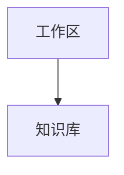

<!-- dooknow:document {"version":1,"type":"flowchart","engine":"mermaid"} -->

# 系统架构

<!-- dooknow:primary:start -->

<!-- dooknow:primary-binding {"version":1,"sourceHash":"aaaaaaaaaaaaaaaaaaaaaaaaaaaaaaaaaaaaaaaaaaaaaaaaaaaaaaaaaaaaaaaa","renderHash":"bbbbbbbbbbbbbbbbbbbbbbbbbbbbbbbbbbbbbbbbbbbbbbbbbbbbbbbbbbbbbbbb","previewHash":"cccccccccccccccccccccccccccccccccccccccccccccccccccccccccccccccc"} -->

<!-- dooknow:primary:end -->

## 说明

说明正文独立保存，不被图形编辑覆盖。
